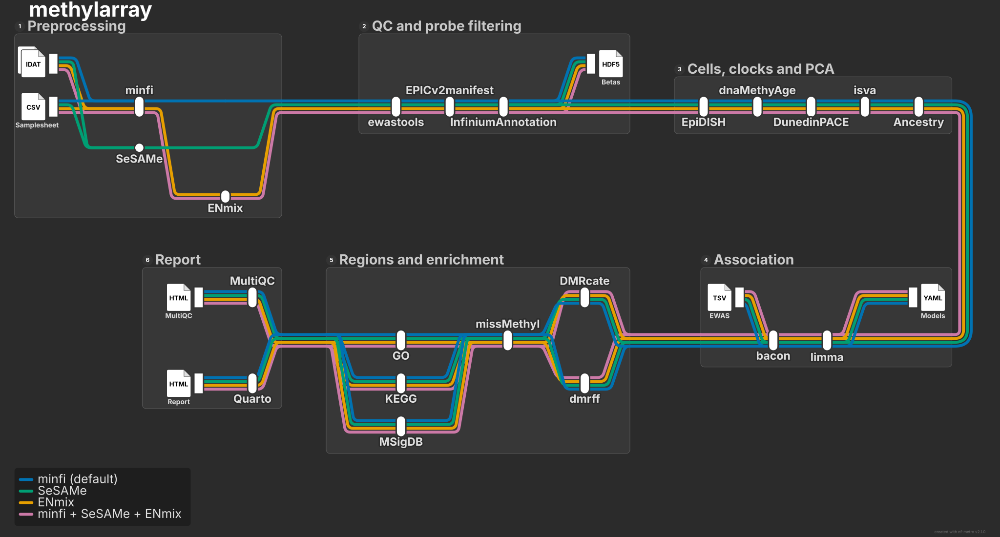

# methylarray

[](https://github.com/bhagesh-h/methylarray/actions/workflows/nf-test.yml)
[](https://github.com/bhagesh-h/methylarray/actions/workflows/linting.yml)
[](https://www.nf-test.com)

[](https://www.nextflow.io/)
[](https://github.com/nf-core/tools/releases/tag/4.2.2)
[](https://www.docker.com/)
[](https://sylabs.io/docs/)
[](https://apptainer.org/)
[](https://docs.conda.io/en/latest/)
[](LICENSE)

## Introduction

**methylarray** is a Nextflow pipeline for Illumina Infinium DNA methylation arrays. It starts from raw IDAT files and produces:

- quality-controlled and normalised methylation matrices
- sample and probe QC reports
- blood cell-type estimates
- DNA methylation biomarkers (epigenetic clocks and DNAm scores)
- epigenome-wide association results
- differentially methylated regions
- pathway and chromatin enrichment
- a MultiQC report and an HTML analysis report

The pipeline is built for the **Infinium MethylationEPIC v2.0 BeadChip** and handles the specific features of that array: replicate probes, the GRCh38 manifest, the `nv` and `rs` probe classes, and the updated cross-hybridisation annotation. It is written in Nextflow DSL2 with strict syntax, built from the nf-core template, and every step runs with pinned software through Docker, Singularity, Apptainer, Podman or conda.



> **Status:** under active development. Version 1.0.0 has not been released. [CHANGELOG.md](CHANGELOG.md) lists what is implemented.

## Pipeline summary

1. Validate the samplesheet, phenotype table and model definitions against JSON schemas (nf-schema).
2. Prepare reference resources once and cache them for offline runs: the SeSAMe data cache, the EPIC v2 manifest and probe masks.
3. Preprocess the arrays with one of five options (see [Preprocessing options](#preprocessing-options)).
4. Run sample QC:
   - Illumina control-probe metrics
   - predicted versus reported sex
   - SNP-based identity and duplicate detection
   - contamination score
   - outlier detection
   - technical-replicate concordance

   Every exclusion is recorded with a reason.

5. Filter probes on the arrays that passed QC, in order:
   - `rs`, `nv` and non-CpG probes, and probes without an hg38 position
   - sex chromosomes (kept with `--keep_sex_chr`)
   - detection failure and low bead count
   - SNP-affected probes (population-specific masks), the Zhou general mask and cross-hybridising probes (Peters et al. 2024)

   Manifest position mismatches and poorly titrating probes are reported but kept. EPIC v2 replicate probes are then collapsed to one value per CpG. A probe attrition table documents each step.

6. Estimate leukocyte proportions with EpiDISH.
7. Compute epigenetic clocks (Horvath, Hannum, skin and blood, PhenoAge, PC clocks, DunedinPACE and others) and DNAm scores (CRP, IL-6, smoking, alcohol, BMI), reporting the probe coverage of each on the array.
8. Explore technical and biological variation:
   - control-probe principal components
   - principal components and their associations with covariates
   - a design-balance check for every model
9. When a models file is given, run epigenome-wide association studies:
   - limma on M-values, with effect sizes reported as differences in beta values
   - bias and inflation control with bacon
   - DMRs from DMRcate and dmrff, keeping regions supported by both
   - gene set and CpG-centric enrichment (missMethyl, KnowYourCG)
10. In parallel mode, compare the preprocessing methods (method concordance).
11. Build a MultiQC report and an HTML report with an automatically generated methods section.

## Preprocessing options

Select one with `--preprocessing`.

| Option            | Route                                                                                                          | When to use it                                                                                                         |
| ----------------- | -------------------------------------------------------------------------------------------------------------- | ---------------------------------------------------------------------------------------------------------------------- |
| `minfi` (default) | minfi import, detection p-values, Noob (Funnorm, quantile or SWAN optional)                                    | Established, widely used route; comparable with most published array studies                                           |
| `sesame`          | SeSAMe per-sample preprocessing: quality masks, channel inference, non-linear dye bias, pOOBAH detection, noob | Each sample is processed on its own, so results do not depend on which other samples are in the run                    |
| `enmix`           | minfi import, ENmix QC, ENmix background with RELIC dye-bias correction, RCP probe-type correction             | Strong replicate agreement in published benchmarks                                                                     |
| `combined`        | minfi import, SeSAMe pOOBAH detection masks, ENmix background with RELIC, RCP                                  | One integrated route that uses the strongest step of each package                                                      |
| `parallel`        | Runs `minfi`, `sesame` and `enmix` side by side through the full analysis, then compares them                  | Sensitivity analysis. Reports concordance of beta values, QC decisions, cell estimates, clocks and association results |

## Requirements

- [Nextflow](https://www.nextflow.io/docs/latest/install.html) 26.04.2 or later (earlier releases can wrongly report remote HTTP or HTTPS input files as missing).
- One of [Docker](https://docs.docker.com/engine/installation/), [Singularity](https://www.sylabs.io/guides/3.0/user-guide/), [Apptainer](https://apptainer.org/docs/user/latest/), [Podman](https://podman.io/) or [conda](https://conda.io/miniconda.html). Containers are recommended.
- Memory:
  - per-sample tasks need about 4 GB
  - steps that combine all samples need about 32 GB for a few hundred EPIC v2 arrays
- Internet access on the first run, to fetch containers and reference resources. Later runs can be offline with `--sesame_cache`.

## Quick start

1. Test the pipeline on the bundled test data:

   ```bash
   nextflow run bhagesh-h/methylarray -profile test,docker --outdir results
   ```

   Replace `docker` with `singularity`, `apptainer`, `podman` or `conda` to match your system. Institutional profiles from [nf-core/configs](https://github.com/nf-core/configs) also work.

2. Prepare a samplesheet (see [Input](#input)).

3. Run the pipeline:

   ```bash
   nextflow run bhagesh-h/methylarray \
       -r <version> \
       -profile docker \
       --input samplesheet.csv \
       --phenotypes phenotypes.tsv \
       --models models.yaml \
       --outdir results
   ```

Pipeline parameters must be passed on the command line or in a `-params-file`. A `-c` config file should only change infrastructure settings such as resources and executors.

## Input

### Samplesheet

A CSV, TSV, JSON or YAML file with one row per array. Required columns are `sample`, `idat_red` and `idat_grn`.

```csv
sample,idat_red,idat_grn,plate,reported_sex
S001,/data/idat/200000000001/200000000001_R01C01_Red.idat,/data/idat/200000000001/200000000001_R01C01_Grn.idat,P01,F
S002,/data/idat/200000000001/200000000001_R02C01_Red.idat,/data/idat/200000000001/200000000001_R02C01_Grn.idat,P01,M
```

| Column                      | Required | Description                                                      |
| --------------------------- | -------- | ---------------------------------------------------------------- |
| `sample`                    | yes      | Unique sample identifier                                         |
| `idat_red`                  | yes      | Red channel IDAT (`_Red.idat` or `_Red.idat.gz`)                 |
| `idat_grn`                  | yes      | Green channel IDAT with the same prefix as the red file          |
| `sentrix_id`                | no       | Chip barcode. Derived from the file name if omitted              |
| `sentrix_position`          | no       | Position such as `R01C01`. Derived from the file name if omitted |
| `plate`                     | no       | Processing plate, used as a batch variable                       |
| `well`                      | no       | Plate well                                                       |
| `batch`                     | no       | Any further processing batch                                     |
| `reported_sex`              | no       | `M` or `F`, compared with the sex predicted from the array       |
| `reported_age`              | no       | Chronological age, used for clock-based checks                   |
| `replicate_group`           | no       | Shared value for technical replicates                            |
| `exclude`, `exclude_reason` | no       | Manual exclusion with a recorded reason                          |

### Phenotypes

An optional CSV or TSV file with a `sample` column and any number of analysis variables. Phenotype values are never written to logs.

### Models

An optional YAML file listing the association models to run. Each model names a trait, its type, an optional transformation and the covariates. Shortcut tokens expand to derived covariates: `@cells` (cell composition), `@technical` (plate and Sentrix row), `@ctrlpcs` (control-probe components), `@sex` (predicted sex) and `@smoking` (DNAm smoking score).

```yaml
- name: bmi
  trait: bmi
  trait_type: continuous
  covariates: [age, "@sex", "@cells", "@technical", "@ctrlpcs", "@smoking"]
- name: crp
  trait: hscrp
  trait_type: continuous
  transform: log
  covariates: [age, "@sex", bmi, "@cells", "@technical", "@ctrlpcs"]
```

Without a models file the pipeline stops after QC, preprocessing, cell composition, biomarkers and exploratory analysis.

## Usage notes

- `--qc_only` stops after sample QC and reporting. Use it to review the QC report and write a sample exclusion file, then pass that file with `--sample_exclusions` in the full run.
- Add `-resume` to reuse completed tasks after a change or failure.
- `--sesame_cache` reuses a reference cache from an earlier run, which allows offline execution.
- Batch effects are modelled as covariates by default. ComBat is available through `--combat_batch` but only runs for models that pass the design-balance check, because ComBat on unbalanced designs can create false positives.
- Run `nextflow run bhagesh-h/methylarray --help` for all parameters. The full description of every option is in [docs/usage.md](docs/usage.md), and the parameter schema is [nextflow_schema.json](nextflow_schema.json).

## Outputs

```text
results/
├── pipeline_info/      execution reports, software versions, validated inputs
├── qc/                 sample QC, control metrics, sex and identity checks, probe attrition
├── preprocessing/      HDF5-backed SummarizedExperiment objects and exported matrices
├── cell_composition/   cell-type proportions and plots
├── biomarkers/         epigenetic clocks and DNAm scores
├── exploratory/        PCA, control-probe components, design checks
├── ewas/               summary statistics, top hits and plots per model, cross-model summary
├── dmr/                DMRcate, dmrff and consensus regions per model
├── enrichment/         gene set and CpG-centric enrichment per model
├── comparison/         method concordance (parallel mode)
├── multiqc/            MultiQC report
└── report/             HTML analysis report with methods text
```

In parallel mode each method writes its own subdirectory under `preprocessing/`, `qc/` and the analysis folders. Every file is described in [docs/output.md](docs/output.md).

## Testing

The pipeline is tested with [nf-test](https://www.nf-test.com) at the module, subworkflow and pipeline level. The `test` profile uses a small public EPIC v2 whole-blood dataset with synthetic phenotypes and runs on a 4 CPU, 15 GB machine. The `test_full` profile runs the complete public dataset.

## Reproducibility

- Each module pins its software in an `environment.yml` and a matching container image.
- Software versions are collected from every task and reported in MultiQC and in `pipeline_info/`.
- Random seeds are fixed, and inputs are sorted before aggregation.
- The exact command, parameters, container digests and pipeline revision are written with every run.

## Data privacy

The pipeline processes data where it runs and does not upload samples, phenotypes or results anywhere. When working with human data, keep IDATs, samplesheets with identifiers, phenotype tables and results out of version control.

## Credits

methylarray is developed and maintained by [bhagesh-h](https://github.com/bhagesh-h).

The design draws on the nf-core/methylarray development pipeline and its contributors, the Garvan Institute EPIC v2 workflow, and the EPIC v2 preprocessing work of the Kobor lab. The workflow diagram is drawn with [nf-metro](https://github.com/seqeralabs/nf-metro) from [assets/metro_map.mmd](assets/metro_map.mmd).

## Contributions and support

Bug reports and feature requests are welcome through GitHub issues. Development happens on the `dev` branch: open pull requests against `dev`, never against `main`. See [docs/CONTRIBUTING.md](docs/CONTRIBUTING.md) before opening a pull request.

## Citations

All tools, methods, reference data and frameworks used by the pipeline are listed in [CITATIONS.md](CITATIONS.md). A Zenodo DOI for the pipeline will be added at the first release.

## License

methylarray is released under the [MIT License](LICENSE).
